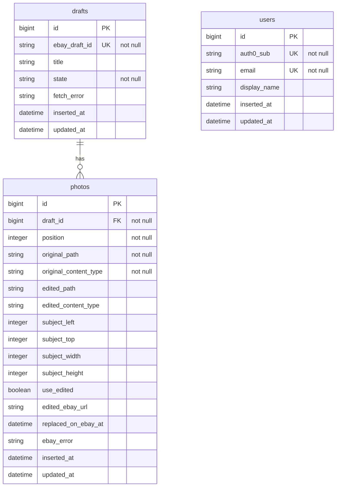

# Entity relationship diagram

Auth follows [Done Manager](https://github.com/dewetblomerus/donemanager): Ueberauth Auth0. A sign-in upserts `users` on `auth0_sub` and refreshes `email` and `display_name`.

One database is the household. Drafts are shared by everyone who can sign in. A multi-tenant SaaS is a rewrite on a fresh database.

## Notes

- Primary keys are `bigint`. Timestamps are UTC instants (`utc_datetime_usec`).
- `drafts.state` is the current state name: `started`, `awaiting_photos`, `photos_taken`, `photo_edits_drafted`, `photo_edits_approved`. Allowed moves live in code. A transition adds a state name or returns to an earlier one. Drafts already past that point stay where they are.
- A draft in `started` has not been read from eBay yet. `awaiting_photos` means it was read and it has no photos. `title` may be empty.
- `drafts.fetch_error` is the last failed read of the Seller Hub draft. A successful read clears it.
- `drafts.ebay_draft_id` is the Seller Hub `draft_id` from a pasted eBay draft URL. It is unique. See [Drafts](drafts.md).
- `photos.position` is unique per draft. Deleting a draft deletes its photos.
- `original_path` and `edited_path` are disk paths. The original is never replaced. The edit job crops that original to the subject box and writes `edited_path` and `edited_content_type`. The background stays. A rework overwrites the edit in place.
- The subject box is `subject_left`, `subject_top`, `subject_width`, and `subject_height`, in pixels of the original. It is the crop: the subject, its margin, and the surroundings that bring it toward a square. Width and height count pixels. All four are null, or all four are present with width and height greater than zero. A check constraint enforces that. The crop reuses this box.
- `photos.use_edited` is true when the person picks the edit and false when they pick the original. It stays null until they choose. The pick approves the draft.
- `edited_ebay_url` is the eBay-hosted copy of the approved edit. `replaced_on_ebay_at` is when the Seller Hub draft saved it as the first photo. `ebay_error` is the last failed replacement. Retry clears it.
- An approved draft sends `edited_path` to eBay only when `use_edited` is true.
- Reaching `photos_taken` enqueues one Oban edit job for the first photo. Later photos are not cropped. The draft moves to `photo_edits_drafted` when that photo has an edit.
