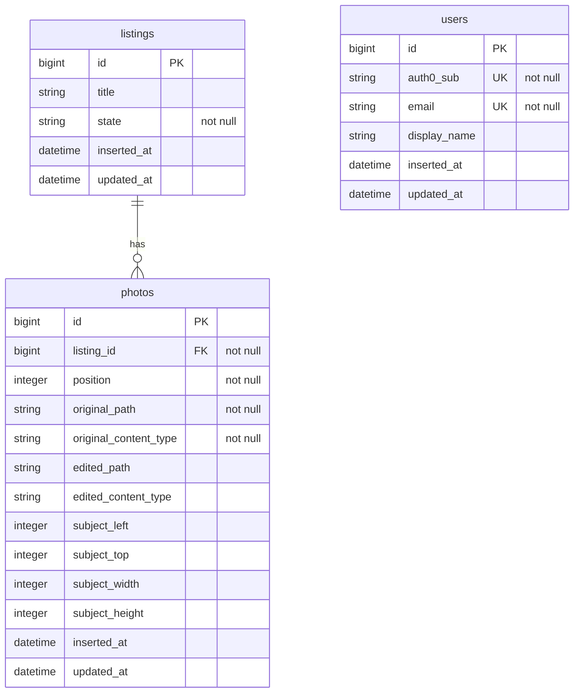

# Entity relationship diagram

Auth follows [Done Manager](https://github.com/dewetblomerus/donemanager): Ueberauth Auth0. A sign-in upserts `users` on `auth0_sub` and refreshes `email` and `display_name`.

One database is the household. Listings are shared by everyone who can sign in. A multi-tenant SaaS is a rewrite on a fresh database.

## Notes

- Primary keys are `bigint`. Timestamps are UTC instants (`utc_datetime_usec`).
- `listings.state` is the current state name: `start`, `photos_taken`, `photo_edits_drafted`, `photo_edits_approved`. Allowed moves live in code. A transition adds a state name or returns to an earlier one. Listings already past that point stay where they are.
- A listing may exist in `start` with no photos. `title` may be empty until the item is named.
- `photos.position` is unique per listing. Deleting a listing deletes its photos.
- `original_path` and `edited_path` are disk paths. The original is never replaced. The edit job writes `edited_path` and `edited_content_type`. A rework overwrites the edit in place.
- The subject box is `subject_left`, `subject_top`, `subject_width`, and `subject_height`, in pixels of the original. Width and height count pixels. All four are null, or all four are present with width and height greater than zero. The crop reuses this box.
- An approved listing uses `edited_path` when it is present.
- The edit job is an Oban job.
