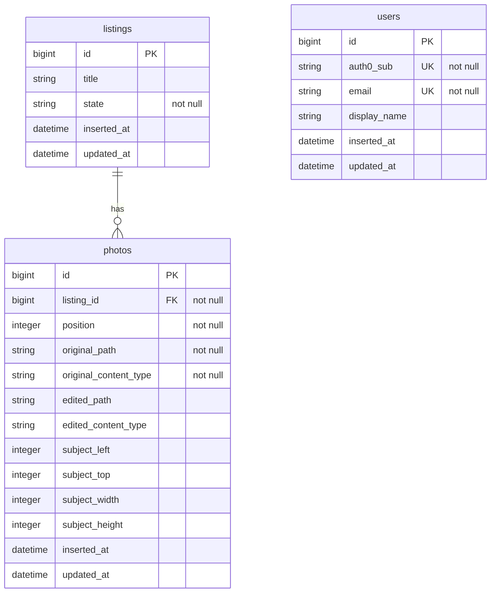

# Entity relationship diagram

Auth follows [Done Manager](https://github.com/dewetblomerus/donemanager): Ueberauth Auth0, no `phx.gen.auth`, no Ash. A sign-in upserts `users` on `auth0_sub` and refreshes `email` and `display_name`. [Mobile Worship](https://github.com/dewetblomerus/mobile-worship) is the other non-Ash Auth0 app; it uses `auth0_id` and organizations, which this app does not need.

One database is the household. There is no tenant table and no `tenant_id`. Listings are shared by everyone who can sign in. A later permission may limit which human step a user can perform, for example an outsourced worker. It does not partition rows. A multi-tenant SaaS would be a rewrite on a fresh database.

eBay credentials, prices, and listing payloads stay out until a later state needs them.

## Notes

- Primary keys are `bigint`. Timestamps are UTC instants (`utc_datetime_usec`).
- `listings.state` is the current state name: `start`, `photos_taken`, `photo_edits_drafted`, `photo_edits_approved`. Allowed moves live in code, not in a table. The name is not a progress number, so a later move can return to an earlier name without rewriting other listings. A check constraint limits the column to the known names and is widened when a name is added. `photo_edits_denied` is not in the initial set.
- A listing may exist in `start` with no photos. `title` may be empty until the item is named.
- `photos.position` is unique per listing. Deleting a listing deletes its photos.
- `original_path` is the raw upload on disk and is never replaced. The edit job writes `edited_path` and the subject box (pixels of the original). Those columns stay null until then. A rework overwrites the edit in place. There is no edit-history table.
- The listing state does not say which file a photo uses. While there is no per-photo choice, an approved listing uses `edited_path` when it is present. A later nullable column on `photos` can record `original` or `edited` for each photo. Old rows stay valid, and no photo needs its own state.
- The resize job is an Oban job argument, not a table. Oban's own tables are not part of this diagram.
