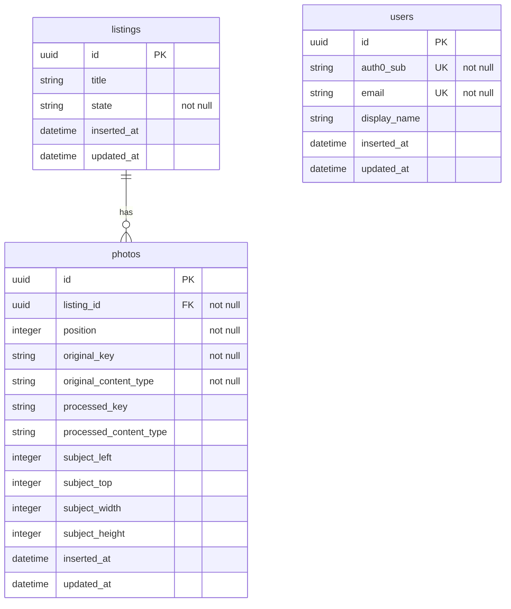

# Entity relationship diagram

Auth follows [Done Manager](https://github.com/dewetblomerus/donemanager): Ueberauth Auth0, no `phx.gen.auth`, no Ash. A sign-in upserts `users` on `auth0_sub` and refreshes `email` and `display_name`. [Mobile Worship](https://github.com/dewetblomerus/mobile-worship) is the other non-Ash Auth0 app; it uses `auth0_id` and organizations, which this app does not need.

One database is the household. There is no tenant table and no `tenant_id`. Listings are shared by everyone who can sign in. A later permission may limit which human step a user can perform, for example an outsourced worker. It does not partition rows. A multi-tenant SaaS would be a rewrite on a fresh database.

eBay credentials, prices, and listing payloads stay out until a later state needs them.

## Notes

- Primary keys are UUIDv7. Timestamps are UTC instants (`utc_datetime_usec`).
- `listings.state` is the current state name: `start`, `photos_taken`, `photos_resized`, `photos_approved`. Allowed moves live in code, not in a table, so a new state can be inserted later without rewriting rows. A check constraint limits the column to the known names and is updated when a state is added.
- A listing may exist in `start` with no photos. `title` may be empty until the item is named.
- `photos.position` is unique per listing. Deleting a listing deletes its photos.
- `original_key` is the raw upload. The resize job writes `processed_key` and the subject box (pixels of the original). Those columns stay null until then. Re-running the job overwrites them. The box is the rembg result, so a later crop does not have to call rembg again.
- The resize job is an Oban job argument, not a table. Oban's own tables are not part of this diagram.
